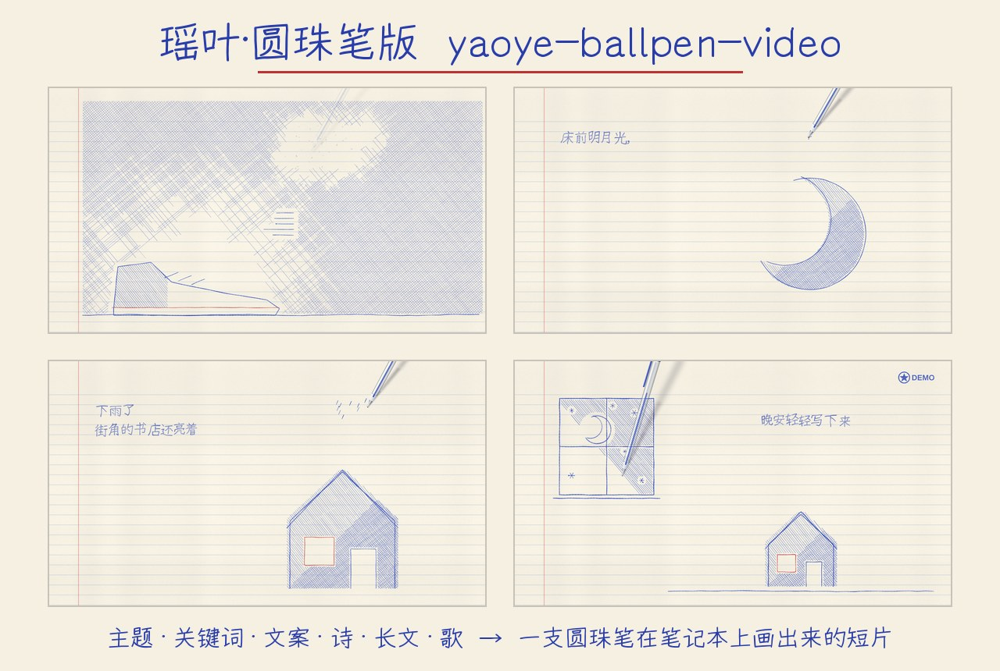
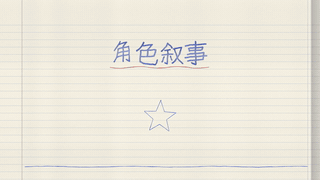
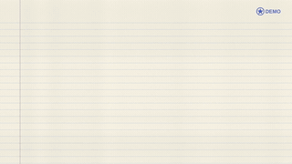

<p align="center">
  
</p>

# 瑶叶·圆珠笔版 · yaoye-ballpen-video

> An AI-agent skill for ballpoint-pen notebook videos. Bring a theme, text, poem or song; create an editable video project.

**一支蓝色圆珠笔，在横线笔记本上把你的内容一笔一笔写出来、画出来。**

给它一个主题、几个关键词、一段文案、一首诗、一篇文章或一首歌，AI 助手会写好（或保留）文字、安排每一页的画面，由一支看得见的圆珠笔手写文字、画线稿、排线上色，用翻页和橡皮擦转场，输出 **1080p 视频 + 手机版**。配乐可选：只有笔声、自动作曲、你的音乐，或跟着歌词同步。

瑶叶 · 一叶知 AI 出品。

[下载完整 Skill](https://github.com/yaoyepro/yaoye-ballpen-video/archive/refs/heads/main.zip)　·　[风格目录](#风格目录)　·　[开始使用](#开始使用)　·　[完整说明（给 AI）](SKILL.md)　·　[更新记录](CHANGELOG.md)

---

## 风格目录

**4 种风格，同一种圆珠笔画风。** 告诉 AI 编号即可，例如“用 **A**”。

<table>
  <tr>
    <td align="center" width="256"><br><strong>A</strong><br><sub>文字 + 涂鸦</sub><br><sub>主题 / 关键词 / 文案 / 长文</sub></td>
    <td align="center" width="256"><br><strong>B</strong><br><sub>诗词夜色</sub><br><sub>诗 / 抒情短句</sub></td>
  </tr>
  <tr>
    <td align="center" width="256"><br><strong>C</strong><br><sub>角色叙事</sub><br><sub>文字 + 你的角色图片（预览为占位框）</sub></td>
    <td align="center" width="256"><br><strong>D</strong><br><sub>歌词 MV</sub><br><sub>歌 + 歌词（+ 你的角色图片）</sub></td>
  </tr>
</table>

横屏 16:9（1920×1080）。预览来自本包示例的实测输出（只有文字和涂鸦；本包不附带任何角色图片，角色图需要你自己提供）。详见[风格目录](references/style-catalog.md)。

---

## 模板特点

| 特点 | 说明 |
| --- | --- |
| **一支笔画完全片** | 文字、线稿、排线都由可见的圆珠笔实时画出，像真的在本子上画 |
| **风格锁定** | 奶油色横线纸、红色边线、蓝色圆珠笔、四层排线、红绿点缀，数值固定，便于保持系列画面一致 |
| **多种文字输入** | 主题、关键词、文案、诗、长文：自动按阅读速度安排时间，不需要音频 |
| **不画“假人”** | 人物只来自真实图片（你的或 AI 生成的），其余用 50 个手绘涂鸦 |
| **声音可选** | 笔声 / 自动作曲 / 你的音乐（自动 -16 LUFS）/ 歌词同步 |
| **字体不卡制作** | 随包 OFL 手写字体，缺字自动提示，指定字体缺失时自动回退 |
| **先看样片再出片** | 先出 20 秒样片给你确认，满意再出完整视频 |

---

## 开始使用

**平台：Windows · macOS · Linux**<br>
**助手：Codex · Claude Code · WorkBuddy · Grok Bot**，以及任何能读取文件并运行命令的 AI 助手（没有 Skill 加载功能时，让它读取本文件夹的 `SKILL.md` 和 `AGENTS.md`）。[平台与助手说明](references/compatibility.md)

| 步骤 | 操作 |
| --- | --- |
| **1 · 安装** | 解压到助手能访问的位置（如 Codex：`~/.codex/skills/yaoye-ballpen-video`）。需要 Node.js 18+、Python 3.10+、ffmpeg。在文件夹里运行：Windows `python bpmv.py setup`，macOS/Linux `python3 bpmv.py setup`，看到 `ALL GOOD` 后，再生成短样片检查画面和声音 |
| **2 · 提供素材** | 一个主题 / 几个关键词 / 一段文案 / 一首诗 / 一篇文章 / 一首歌（音频+歌词）。想要角色出镜，再给几张角色图片（或让 AI 生成） |
| **3 · 选择与制作** | 告诉 AI 风格编号、时长、配乐和输出位置；不确定就让 AI 推荐。先确认方案和 20 秒样片，再出完整视频 |

> **首次安装时间取决于网络与电脑环境**（需要下载依赖）。做歌词 MV 还需要语音识别组件（约 2 GB）：`setup --audio`。

### 让 AI 引导你开始

```text
加载 yaoye-ballpen-video，引导我开始创作。
```

AI 会一步一步问你内容、时长、配乐，不需要一次填完。

### 已有内容，直接制作

```text
使用 yaoye-ballpen-video，风格 A，主题“和太阳奔跑”，30 秒，自动配乐，
输出到 D:\ballpen\sun。先给我看方案和样片。
```

---

## 使用资料

[开始创作](references/start-creating.md)　·　[风格目录](references/style-catalog.md)　·　[script.json 范例](references/script-examples.md)　·　[音乐](references/music.md)　·　[平台兼容](references/compatibility.md)　·　[常见问题](references/troubleshooting.md)

版本 **1.0.1**　·　瑶叶 · 一叶知 AI 出品　·　[AI 执行入口](SKILL.md)　·　[MIT License](LICENSE)　·　[第三方说明](THIRD_PARTY.md)


## 反馈与支持

遇到问题，请在 [Issues](https://github.com/yaoyepro/yaoye-ballpen-video/issues) 写明系统、操作步骤和报错；请先去掉密钥、个人路径及未授权素材。

如果这个 Skill 帮你做出了喜欢的视频，欢迎点右上角 **Star** 收藏支持，也欢迎分享作品与使用反馈。

## 许可与验证范围

代码与文档沿用 [MIT](LICENSE)；随包字体与其他素材按 [第三方说明](THIRD_PARTY.md) 保留各自许可。使用者自行提供的音乐、人物图片和字体不包含在本项目授权中。

本次发布保留原包 1.0.1 的功能。原包中的跨平台测试描述来自随包文档，不代表本次已在所有平台重跑；本次实际验证记录见 [发布核验](references/release-verification.md)。手机输出为缩小分辨率的版本，不应理解为所有场景均已提供竖屏重排。
